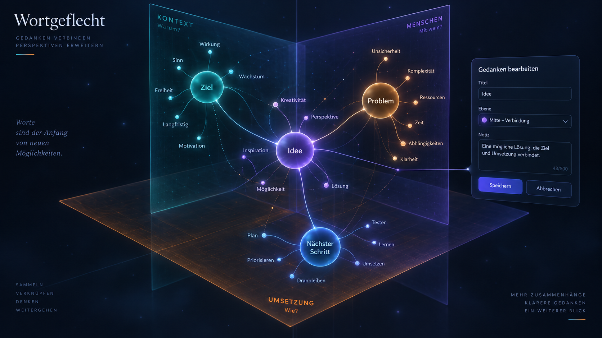
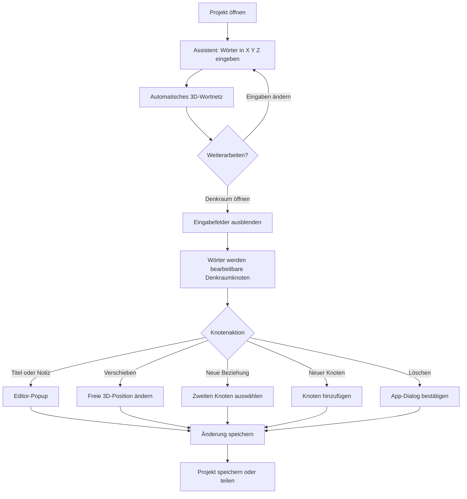
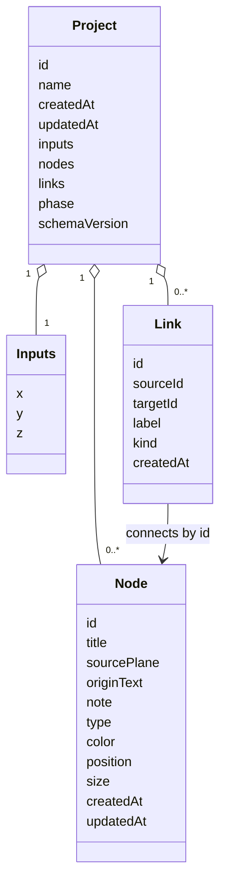

# Projektausbau: Wortgeflecht als räumlicher Denkraum

Wortgeflecht begann als 3D-Erweiterung einer Mindmap: Drei Texte erzeugen heute automatisch ein räumliches Wortnetz. Der nächste Ausbau macht daraus einen Assistenten mit anschließender Denkraum-Ansicht.

Die Visualisierung ist ein Funktionskonzept. Sie zeigt die gewünschte Richtung, ist aber noch kein fertiges UI-Layout.

## Grundidee: ein Knotentyp, zwei Arbeitsphasen

Die Wörter aus den drei Eingabefeldern sind von Anfang an die eigentlichen Denkraumknoten. Es gibt keine dauerhafte Trennung zwischen Wortknoten und Gedankenknoten.

Die Anwendung hat stattdessen zwei Arbeitsphasen:

1. **Initialbefüllung**: Drei Eingabefelder dienen als schnelle Eingabe. Aus X, Y und Z wird das bestehende 3D-Wortnetz aufgebaut; gleiche Wörter werden weiterhin automatisch verkettet.
2. **Denkraum**: Nach `Denkraum öffnen` verschwinden die Eingabefelder. Die Wörter bleiben als bearbeitbare Knoten sichtbar und werden weiterentwickelt: umbenennen, verschieben, beschreiben, verbinden, gruppieren und löschen.

Die Eingabefelder sind damit ein Initialisierungsassistent und keine zweite dauerhafte Bedienoberfläche.

## Leseschlüssel für die Visualisierung

Im Bild sind die kleinen Begriffe die aus den Eingabefeldern erzeugten Startknoten. Die großen Kreise zeigen dieselben Knoten in einer ausgearbeiteten Denkraumdarstellung:

- `Ziel`: ein aus einem Ausgangswort entwickelter Knoten für das gewünschte Ergebnis
- `Idee`: ein weiterentwickelter Knoten mit eigener Bedeutung oder Notiz
- `Problem`: ein als Hindernis oder offene Frage markierter Knoten
- `Nächster Schritt`: ein als konkrete Aktion weiterentwickelter Knoten

Die Größen und Farben zeigen im Konzept den Bearbeitungsgrad und die Bedeutung. Sie stellen keine zusätzlichen Knotentypen dar.

Die drei Farben markieren weiterhin die Herkunft aus der Initialbefüllung:

- Türkis: Eingabefeld X / Kontext
- Violett: Eingabefeld Y / Menschen und Beziehungen
- Orange: Eingabefeld Z / Umsetzung

## Funktionen im Denkraum

### Initialbefüllung

- Wörter in X, Y und Z eingeben oder einfügen
- vorhandene Wortketten und gemeinsame Wörter sofort sehen
- Eingaben automatisch als letzte Fassung speichern
- mit `Denkraum öffnen` in die dauerhafte Arbeitsansicht wechseln

### Knoten weiterentwickeln

Jeder Startknoten kann im Denkraum bearbeitet werden:

- Titel ändern
- Notiz ergänzen
- Farbe und Darstellung ändern
- Bedeutung markieren, zum Beispiel `Ziel`, `Idee`, `Problem` oder `Aktion`
- Größe oder Hervorhebung festlegen
- frei im 3D-Raum verschieben
- duplizieren oder löschen

Ein neu angelegter Knoten verwendet denselben Knotentyp wie ein aus einem Wort entstandener Knoten. Der Unterschied liegt nur darin, ob er aus der Initialbefüllung stammt oder später ergänzt wurde.

### Verbindungen

Die automatische Verkettung gleicher Wörter bleibt als Startstruktur erhalten. Im Denkraum können zusätzlich manuelle Verbindungen angelegt werden:

1. Einen Knoten auswählen.
2. `Verbindung erstellen` aktivieren.
3. Einen zweiten Knoten anklicken.
4. Optional eine Bezeichnung wie `führt zu`, `betrifft`, `braucht` oder `ähnlich` eingeben.

Manuelle Verbindungen können zwischen beliebigen Denkraumknoten entstehen. Die automatische Wortverkettung und die manuellen Beziehungen werden im UI unterschiedlich dargestellt, bleiben aber Teil desselben Netzes.

### Räumliche Position

Die Herkunftsebenen X, Y und Z bleiben als visuelle Orientierung erhalten. Nach dem Wechsel in den Denkraum sind die Knoten jedoch frei im 3D-Raum positionierbar. Die ursprüngliche Ebene ist eine Herkunftsinformation, keine feste Bewegungsgrenze.

Beim Öffnen des Denkraums können die Knoten zunächst auf ihren bisherigen Ebenen liegen. Danach dürfen sie frei verschoben werden. Der Nutzer kann so `Idee` zentral, `Problem` seitlich und `Nächster Schritt` näher an der Umsetzung anordnen.

## Interaktionsablauf

## Datenmodell

Gespeichert werden nicht mehr getrennte Wort- und Gedankenknoten, sondern ein einheitlicher Knotenbestand. Die drei Eingabefelder bleiben als Quellen erhalten, damit der Assistent erneut geöffnet und die Initialbefüllung nachvollzogen werden kann.

### Bedeutung der Felder

- `inputs`: letzte Inhalte der drei Initialfelder.
- `nodes`: einheitliche Denkraumknoten, unabhängig davon, ob sie aus einem Wort entstanden oder später ergänzt wurden.
- `sourcePlane`: ursprüngliche Herkunft `x`, `y`, `z` oder `null` für später zentral ergänzte Knoten.
- `originText`: ursprüngliches Wort, bevor der Titel weiterentwickelt wurde.
- `type`: semantische Markierung wie `thought`, `goal`, `problem` oder `action`; kein eigener Knotentyp im technischen Sinn.
- `phase`: `seed` für die Initialbefüllung oder `workspace` für den geöffneten Denkraum.
- `links.kind`: `automatic` für die ursprüngliche Wortverkettung oder `manual` für bewusst angelegte Beziehungen.

## Festgelegte Produktentscheidungen

- Die neue Seite heißt `denkraum.html` und ist über die bestehende Seite erreichbar.
- Der Denkraum startet leer und zeigt einen kurzen Assistentenhinweis.
- Die Initialbefüllung verwendet weiterhin drei getrennte Felder für X, Y und Z.
- Nach `Denkraum öffnen` liegen die Knoten zunächst auf ihren Herkunftsebenen und können danach frei im 3D-Raum verschoben werden.
- Knoten werden über ein UI-Popup bearbeitet; Doppelklick ist zunächst nicht erforderlich.
- Gleiche Wörter werden während der Initialbefüllung automatisch verbunden und bleiben im Denkraum sichtbar.
- Manuelle Verbindungsbeschriftungen wie `führt zu` oder `Problem für` kommen in einer späteren Ausbaustufe.
- Neue Knoten werden ausschließlich über den Button `Knoten hinzufügen` angelegt.
- Der Denkraum speichert automatisch und bietet zusätzlich einen ausdrücklichen `Projekt speichern`-Button.
- Denkraum-Projekte werden getrennt von den bestehenden Wortnetz-Projekten gespeichert.
- Die neue Seite erhält ein eigenes Share-Format und eigene Share-URLs.
- Die mobile Version bleibt vollständig bearbeitbar und verwendet eine vereinfachte Werkzeugleiste.
## Was technisch noch zu tun ist

### 1. Assistent und Phasenwechsel

- Zustand für `seed` und `workspace` ergänzen.
- `Denkraum öffnen` als sichtbare Hauptaktion einführen.
- Eingabefelder im Workspace ausblenden, ohne ihre Inhalte zu verlieren.
- Rückkehr zur Initialbefüllung ermöglichen, ohne Denkraumänderungen zu verlieren.
- Beim Phasenwechsel Startknoten aus X, Y und Z erzeugen oder aktualisieren.

### 2. Einheitliches Datenmodell

- Projektschema auf `schemaVersion: 2` erweitern.
- `inputs`, `nodes`, `links` und `phase` in `createProject()` ergänzen.
- Alte Projekte mit drei clouds in das neue Modell migrieren.
- Titeländerungen, `originText` und `sourcePlane` stabil speichern.
- Automatische und manuelle Links getrennt validieren.

### 3. Rendering und Geometrie

- Die bestehenden Wortknoten als einheitliche Denkraumknoten weiterverwenden.
- Größe, Farbe, Typ und Notizsichtbarkeit pro Knoten dynamisch darstellen.
- Knotenpositionen nach dem Phasenwechsel frei beweglich machen.
- Herkunftsebenen weiterhin als Orientierungslinien oder dezente Ebenen anzeigen.
- Kamera-Fitting um alle bearbeiteten Knoten erweitern.

### 4. Interaktion und UI

- Editor-Popup für Titel, Notiz, Typ, Farbe und Größe als Template ergänzen. Der erste Editor-Meilenstein ist jetzt in `denkraum.html` vorhanden.
- `Knoten hinzufügen`, `Verbindung erstellen`, `Bearbeiten`, `Duplizieren` und `Löschen` ergänzen.
- Auswahlzustände und Verbindungsmodus tastatur- und touchfähig machen.
- Alle Rückfragen über App-Dialoge anzeigen; keine Systemdialoge verwenden.
- Denkraum-Toolbar und sichtbare Phasenanzeige gestalten.

### 5. Speichern, Teilen und Offline

- Denkraumzustand und einheitliche Knoten in IndexedDB speichern.
- Share-Payload um `inputs`, `nodes`, `links` und `phase` erweitern.
- Geteilte Denkraumprojekte beim Öffnen als neue lokale Projekte instanziieren.
- URL-Größe vor dem Teilen messen und bei Überschreitung Datei-Export anbieten.
- Neue Module, Templates und Styles in die Service-Worker-App-Shell aufnehmen.

### 6. Tests

- Unit-Tests für Phasenwechsel, Migration, Knotennormalisierung und Linkvalidierung ergänzen.
- DOM-Tests für Assistent, Editor, Toolbar und Bestätigungsdialoge ergänzen.
- Browser-Test: Initialfelder ausfüllen und Wortnetz prüfen.
- Browser-Test: Denkraum öffnen und Eingabefelder ausblenden.
- Browser-Test: Knoten umbenennen, verschieben, typisieren, verbinden und löschen.
- Browser-Test: Projekt speichern, neu laden und den Workspace wiederherstellen.
- Browser-Test: Share-URL mit bearbeiteten Knoten öffnen.
- Browser-Test: Denkraum offline aus der PWA-App-Shell laden.

## Empfohlene Reihenfolge

1. Phasenmodell und neues Projektschema
2. Bestehende Wortknoten als einheitliche Knoten stabilisieren
3. Denkraum öffnen und Eingabefelder ausblenden
4. Editor für Titel, Notiz und Typ
5. Freie Positionierung und Löschen
6. Manuelle Verbindungen
7. Projekt-Import/Export und Teilen erweitern
8. Offline- und Browser-Regressionstests

Der erste nutzbare Meilenstein ist erreicht, sobald Wörter über den Assistenten eingegeben, als Denkraum geöffnet, umbenannt, verschoben, gespeichert und wieder geladen werden können. Verbindungen und semantische Typen bauen darauf auf.
